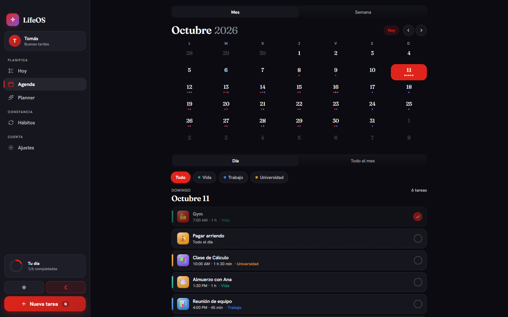
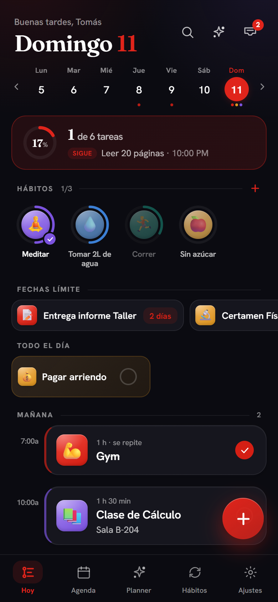

# LifeOS

Planner diario y seguimiento de hábitos. Tu día en una línea de tiempo, tus hábitos con su
historial, y un planner que entiende frases como *"gym mañana 7am 1h"*.

Funciona sin conexión, se instala como app y **no tiene cuentas ni servidor**: todo lo que
escribes se queda en tu dispositivo.

**En vivo:** https://habit-app.tomas-sotz.workers.dev

<p align="center">
  
  
</p>

## Qué hace

- **Hoy** — línea de tiempo del día por mañana, tarde y noche, con marcador de "ahora";
  completar con un toque; pasos (checklist) con progreso; tareas de todo el día; fechas límite
  con cuenta regresiva. La tira de la semana lleva a cualquier otro día.
- **Agenda** — mes y semana, con filtros por tema (vida, trabajo, universidad).
- **Tareas repetidas** — cada día, de lunes a viernes o los días que elijas. Cada día se
  completa, se mueve o se borra por separado, y cualquier cambio se puede aplicar a ese día o
  a toda la serie.
- **Hábitos** — frecuencia diaria, entre semana o días específicos; calendario mensual y mapa
  de consistencia.
- **Bandeja** — anota un pendiente sin pensar cuándo; agéndalo después con un toque.
- **Rutinas** — packs de tareas reutilizables (Pomodoro, mañana ideal, las tuyas) que se
  agendan de una vez en los huecos libres.
- **Planner por frases** — crea, completa, mueve o borra tareas escribiendo o dictando en
  español, y responde "¿qué tengo mañana?". Es un intérprete de reglas que corre en el
  dispositivo, no un modelo de lenguaje: si no entiende, lo dice.
- **Deshacer** — lo que eliminas se puede recuperar durante unos segundos.
- **Modo enfoque** — temporizador a pantalla completa para la tarea en curso.
- **Tus datos** — exporta e importa un respaldo en JSON cuando quieras; Ajustes recuerda
  cuándo fue el último.

Con teclado: `N` nueva tarea, `/` buscar, `T` volver a hoy, `Esc` cerrar.

## Privacidad

No hay registro, analítica ni llamadas a terceros: la app son archivos estáticos y los datos
viven en el almacenamiento del navegador (`localStorage`). Las tipografías se sirven desde el
mismo sitio. La contrapartida es que **no hay sincronización entre dispositivos**: para llevar
tus datos a otro teléfono, exporta un respaldo e impórtalo allí.

## Cómo está hecha

| Parte | Tecnología |
|---|---|
| Interfaz | React 18 (componentes en `src/lifeos-*.jsx`, estilos en línea + `src/styles.css`) |
| Lógica y datos | TypeScript estricto en `src/domain/` (sin dependencias de React ni del DOM) |
| Build | Vite → sitio estático en `dist/` |
| Sin conexión | Service worker propio (`src/sw.template.js`), generado en cada build |
| Hosting | Cloudflare Workers (solo archivos estáticos) |
| Pruebas | Vitest (lógica) y Playwright (navegador: móvil, escritorio y WebKit) |

Más detalle en [docs/ARQUITECTURA.md](docs/ARQUITECTURA.md).

## Desarrollo

Requiere Node 22 o superior.

```bash
npm ci
npm run dev          # servidor de desarrollo con recarga
npm run check        # todo lo que corre la integración continua
```

Por separado:

```bash
npm run lint         # ESLint
npm run typecheck    # TypeScript (src/domain y pruebas)
npm test             # pruebas de la lógica (Vitest)
npm run build        # genera dist/
npm run test:e2e     # pruebas en navegador contra el build (Playwright)
npm run preview      # sirve dist/ igual que producción (cabeceras incluidas)
```

Las pruebas de navegador usan los navegadores de Playwright (`npx playwright install chromium`).
Para usar uno del sistema: `CHROME_PATH=/usr/bin/chromium npm run test:e2e` (en Windows sirve
la ruta de Edge o Chrome). En un equipo modesto, `-- --workers=2` evita esperas agotadas.

## Publicación

Cada cambio en `main` se publica solo: Cloudflare construye el sitio (`npm run build`) y sirve
`dist/`. El procedimiento completo, la verificación posterior y cómo volver atrás están en
[docs/DESPLIEGUE.md](docs/DESPLIEGUE.md).

## Documentación

- [docs/ARQUITECTURA.md](docs/ARQUITECTURA.md) — módulos, modelo de datos, modo sin conexión, seguridad.
- [docs/DESPLIEGUE.md](docs/DESPLIEGUE.md) — cómo se publica y se verifica.
- [docs/DECISIONES.md](docs/DECISIONES.md) — decisiones de producto y sus motivos.
- [docs/BITACORA.md](docs/BITACORA.md) — registro fechado de cambios importantes.
